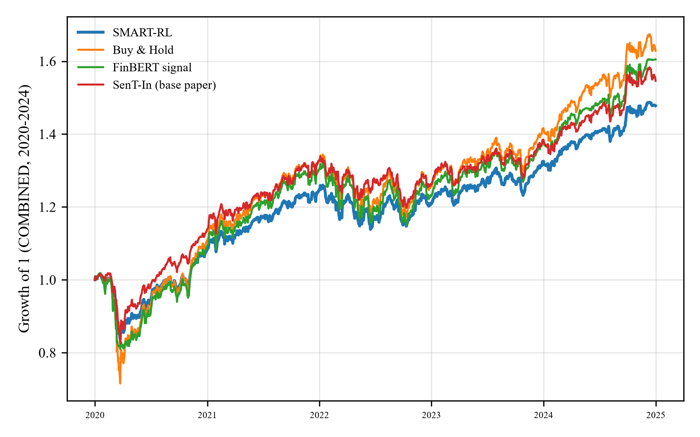

# SMART-RL

**An adaptive trading system based on reinforcement learning, financial sentiment analysis and dynamic weighting**

[](environment.yml)
[](LICENSE)
[](docs/SPEC.md)
[](tests/test_results_contract.py)

Code, run records and results of my M.Sc. thesis in Artificial Intelligence, *Design and Implementation of an Adaptive Intelligent Trading System Based on Reinforcement Learning, Sentiment Analysis, and Dynamic Weighting*, Islamic Azad University, Shiraz Branch (supervisor: Dr. Ali Tabarzad).

SMART-RL combines four learned components and lets an adaptive weighting system decide, every day, how much to trust each of them:

| module | role |
|---|---|
| **SentiFlow** | headline sentiment: a GRU→CNN branch and a FinBERT branch fused by an attention gate, then temperature-calibrated |
| **MarketMind** | a patch-based Informer with a sentiment-aware gate; quantile return forecasts (q10, q50, q90) at 1, 5 and 20 days and realised-volatility forecasts at 5 and 20 days |
| **Trade agent** | a PPO policy with a risk-adjusted reward and an AWS-guided curriculum, run as a seed ensemble |
| **AWS** | adaptive weighting between the RL expert and the sentiment trading module: each expert keeps a virtual book, and its weight is a softmax of its recent EWMA Sharpe ratio and its own confidence |

The system is evaluated on four equity indices (S&P 500, FTSE 100, Nifty 50, SSE Composite) and on their equal-weight combination, against nine baselines (from buy-and-hold to LSTM, FinBERT, SAC and the reproduced base paper, SenT-In by Chauhan et al., 2025), five ablations and a random-policy placebo.

## How the study was run

The design was frozen in [`docs/SPEC.md`](docs/SPEC.md) and [`docs/EXPERIMENTS.md`](docs/EXPERIMENTS.md) before any experiment, and the rules the implementation had to follow are in [`docs/PROJECT_RULES.md`](docs/PROJECT_RULES.md). In short:

- **Test lock.** Every read of data dated 2020-01-01 or later goes through `smartrl/data/access.py`, which refuses unless `locks/G4.lock` holds the SHA-256 of the frozen configuration. The lock was set on 2026-10-21, after the development phase and before any trading result on test data existed.
- **Walk-forward confirmation, 2020–2024.** For test year Y: train 2010..Y−2, validate Y−1, test Y.
- **A forward test on unseen data**, 2025-01-01 to 2026-09-30 (457 trading days), run once with the locked configuration.
- **Every configuration ever tried is logged** (50 in `results/dev_trials.jsonl`), so the deflated Sharpe ratio and the probability of backtest overfitting count all of them.
- **No hand-typed numbers.** Every value in a report, table or figure is read from `results/results.json` by key; `tests/test_results_contract.py` checks the 936 keys the thesis uses (0 missing, 0 null).
- **Causality tests** (`tests/test_leakage.py`) passed at every gate, G1 to G5.
- **Run records.** Each of the 686 runs writes `results/runs/<id>/meta.json` with the configuration hash, git commit, seed, hardware and package versions.

Compute: 40.1 GPU-hours and 13.0 CPU-hours on a laptop with an RTX 2060 (6 GB); 732 policies trained in the confirmation phase.

## Results

All numbers below are copied from [`results/FINAL_RESULTS.md`](results/FINAL_RESULTS.md), which is generated from `results/results.json` and shows the key of every value. Costs are 10 bps per unit of turnover.

**Combined portfolio, walk-forward test years 2020–2024**

| method | Sharpe | max drawdown | ann. volatility | Calmar | turnover |
|---|---:|---:|---:|---:|---:|
| **SMART-RL** | **0.712** | **−17.6 %** | **8.3 %** | 0.447 | 0.018 |
| Buy & hold | 0.646 | −29.7 % | 12.8 % | 0.332 | 0.000 |
| FinBERT signal | 0.725 | −20.4 % | 10.7 % | 0.468 | 0.009 |
| Base paper (SenT-In) as a signal | 0.735 | −19.0 % | 9.4 % | 0.463 | 0.063 |
| PPO, price only | 0.492 | −14.4 % | 5.8 % | 0.331 | 0.031 |

<p align="center">
  
</p>

What the data support:

- **Risk reduction.** Against buy-and-hold, the maximum drawdown falls from −29.7 % to −17.6 % and volatility from 12.8 % to 8.3 %; the drawdown is smaller in 4 of 4 markets and in 5 of 5 test years.
- **Not dominated.** SMART-RL ranks 3rd of 10 by Sharpe, statistically tied with the two methods above it, and no baseline is significantly better (Hansen SPA p = 0.430). The 90 % Model Confidence Set retains it, together with all other methods, so the test does not separate them.
- **Sentiment carries the economic value.** Removing the sentiment pathway lowers the Sharpe from 0.712 to 0.371 (bootstrap p = 0.041).
- **AWS stabilises decisions.** Against the PPO ensemble alone it halves daily turnover (0.0338 → 0.0172, p = 0.003) and lowers the decision flip rate from 0.439 to 0.295 (p < 0.001). The weight on the RL expert rises from 0.477 in bull regimes to 0.590 in bear regimes.
- **Forward test (2025-01 to 2026-09).** Sharpe 1.045 against 1.022 for buy-and-hold and 0.815 for the base paper's strategy; drawdown −6.6 % against −9.9 % and −9.0 %.
- **Low overfitting risk.** Probability of backtest overfitting 0.152 (CSCV, 16 blocks).

What the data do not support, reported as pre-registered: under the strict rules of SPEC §12 (significance after Holm correction against every comparator), hypotheses H1, H2, H4, H6 and H7 are not supported and H3 and H5 are partially supported. The verdict for each hypothesis, the decisive test and the parts that do hold are in section 3 of `FINAL_RESULTS.md`.

### A finding about the base paper

Under the causal protocol of this thesis, the base paper's SenT-In model predicts next-day direction at chance (accuracy 0.501, AUC 0.503). A pre-registered decomposition (E13x) shows that its apparent accuracy of about 0.641 under the published protocol comes from forward-filled calendar days (weekend and holiday rows, which are never "up"), not from information in the news. Re-run under the paper's own window, row count and 80:20 split (E14), the proposed MarketMind classifier beats SenT-In on AUC-ROC (0.712 vs 0.511, chronological split) and PR-AUC (0.875 vs 0.698), Holm-adjusted p < 0.001. On rows that are followed by a real trading session, every model, SenT-In included, is at chance.

## Repository layout

```
configs/    frozen.yaml (every parameter; hashed at G4), p6.yaml, paths.yaml
docs/       SPEC.md, EXPERIMENTS.md, RESULTS_SCHEMA.md, PROJECT_RULES.md, P6_BASE_PROTOCOL.md, THESIS_KEYS.txt
smartrl/    data · sentiflow · marketmind · env · agents · stm · aws · baselines · evaluation · stats · figures
scripts/    one entry point per phase and experiment (p0_* … p6_*), make_final_results.py
tests/      test_leakage.py, test_results_contract.py, test_news_pipeline.py, test_daily_features.py
results/    results.json, FINAL_RESULTS.md, dev_trials.jsonl, tables/, figures/, logs/, runs/<id>/meta.json
reports/    one gate report per phase, P0–P6 (Persian summary, English details)
```

Figures carry Persian labels with the Latin name in parentheses, because they go directly into the Persian thesis.

## Reproducing

```bash
conda env create -f environment.yml && conda activate smartrl-thesis
pip install torch --index-url https://download.pytorch.org/whl/cu126   # match your driver
pytest tests -q        # tests that need later-phase files fall back to synthetic data
```

Data are not redistributed. Prices come from Yahoo Finance, headlines from the `financial-news-multisource` corpus on Hugging Face, and the labelled sentiment sets from their public sources (SPEC §2). The phase scripts in `scripts/` rebuild every panel, model and result in order, and `scripts/make_final_results.py` regenerates `FINAL_RESULTS.md`. Local paths go in `configs/paths.yaml`.

## Citation

```bibtex
@mastersthesis{morshed2026smartrl,
  author = {Morshed, Roham},
  title  = {Design and Implementation of an Adaptive Intelligent Trading System Based on Reinforcement Learning, Sentiment Analysis, and Dynamic Weighting},
  school = {Islamic Azad University, Shiraz Branch},
  year   = {2026},
  note   = {M.Sc. thesis in Artificial Intelligence}
}
```

## License

Code is released under the [MIT License](LICENSE). This is research code; nothing here is investment advice.
